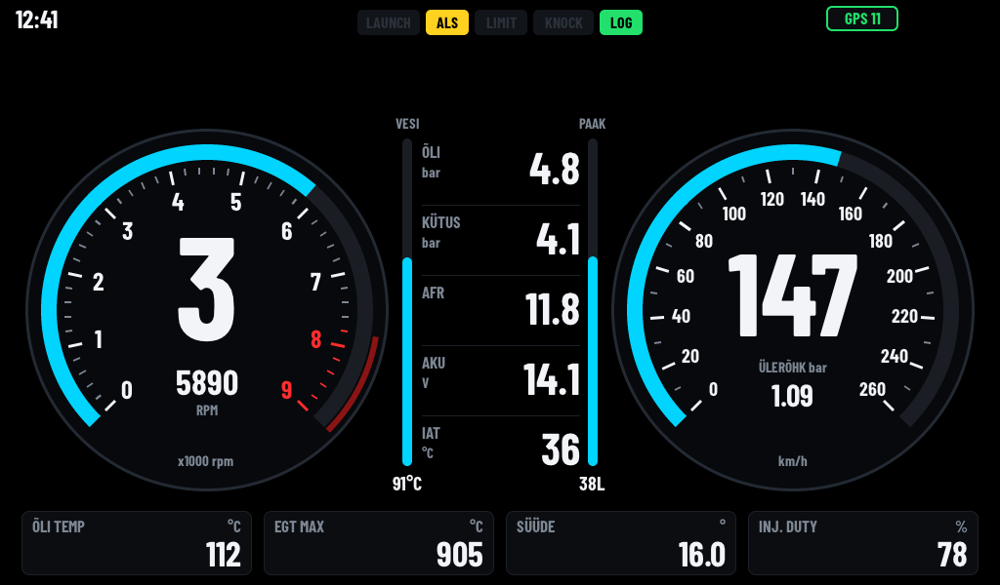
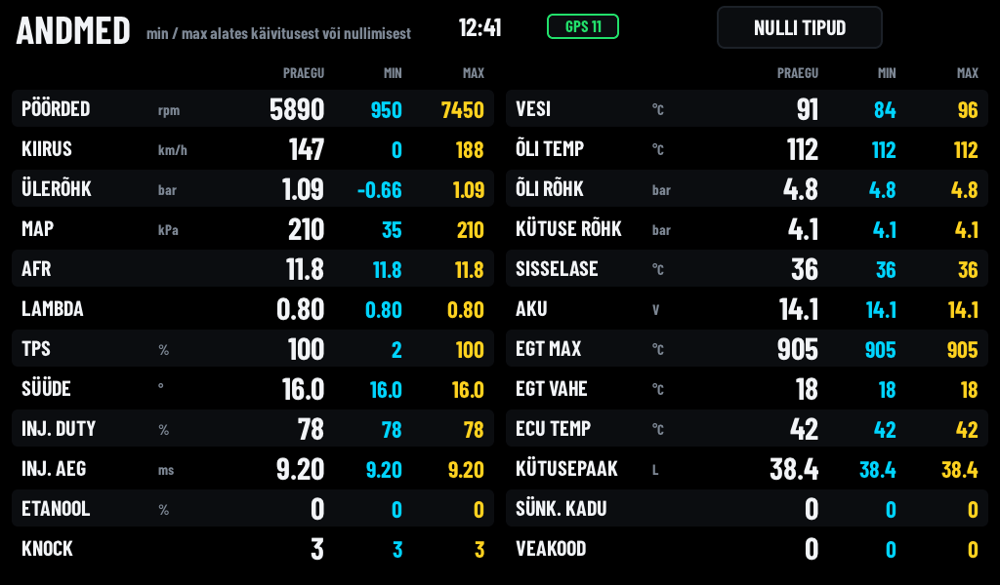

<p align="center"></p>

<p align="center"><b>▶ <a href="https://1mreausta.github.io/SimplDash/">Proovi simulaatorit brauseris</a></b> – töötab ka telefonis, midagi pole vaja installida.</p>

Digitaalne näidikuplokk (race dash) MaxxECU ajule: loeb CAN-siinilt MaxxECU andmeid ja näitab neid
7" puuteekraanil. Plaat: Guition JC1060P470C (ESP32-P4, 1024×600).

*A race-style digital dash for MaxxECU engine controllers. [Try the simulator in your browser](https://1mreausta.github.io/SimplDash/). Reads the MaxxECU CAN protocol and shows it on a
7" ESP32-P4 touch display (Guition JC1060P470C). Five swipeable views, warnings, demo mode and a desktop
simulator. Documentation is in Estonian.*

| RACE | KELLAD |
|---|---|
|  |  |
| **KAAR** | **TÄNAV** |
|  |  |
| **0–100** (GPS) | **RING** (GPS) |
|  |  |
| **ANDMED** | |
|  | |

MaxxECU → CAN (500 kbit/s) → SN65HVD230 → ESP32-P4 TWAI → LVGL dash.
Käivitub umbes sekundiga; väljalülitamisel pole midagi, mis võiks rikki minna.

## Ühendused

Plaadi päis, parem tulp (ülevalt alla):

| Pin | Signaal | Ühendus |
|---|---|---|
| 1 | 5V | ← muunduri 5 V |
| 2 | 5V | – |
| 3 | GND | ← muunduri GND |
| 4 | NC | – |
| 5 | GPIO47 | vaate nupp (valikuline): nupp GPIO47 ja GND vahele |
| 6 | **GPIO46** (CAN RX) | ← SN65HVD230 **CRX** |
| 7 | **GPIO45** (CAN TX) | → SN65HVD230 **CTX** |
| 8 | GND | — SN65HVD230 **GND** |
| 9 | **3V3** | → SN65HVD230 **3V3** (mitte 5 V!) |

SN65HVD230 teine pool: **CANH** → MaxxECU **hall** juhe, **CANL** → MaxxECU **roosa** juhe.
Plaadi GND peab olema ühendatud ka auto/ECU massiga (muunduri kaudu).

Toide: 12 V → 5 V muundur (≥ 2 A, auto/24 V sisendiga) → päise 5V/GND.

> GPIO45/46 on valitud riistvara planeerimisel (plaadi päisest välja toodud ja plaaditugi neid
> ei kasuta). Kui muudad ühendusi, muuda ka tarkvaras:
> `idf.py menuconfig` → **SimplDash** → CAN TX/RX GPIO.
>
> Kasutusel (ära vali): 0, 6–19, 23, 26–31, 34, 35, 39–44, 48–54.

**Terminaator:** MaxxECU CAN1-l on 120 Ω sees. Paljudel SN65HVD230 moodulitel on samuti
120 Ω peal – nii on buss mõlemast otsast lõpetatud. Mõõda CANH–CANL vahel (toide väljas): ~60 Ω = õige.

## MTune
CAN → Output protocol **MaxxECU Default 1.3**, CAN1 bitrate **500 kbit/s**.

## Valmis püsivara laadimine (ilma ESP-IDF-ita)
Iga [reliisi](https://github.com/1mreausta/SimplDash/releases) juures on üks fail `simpldash-vX.Y.bin`,
mis laaditakse aadressile **0x0**. Ühenda plaat USB-C kaudu ja:

- **brauseris:** ava https://espressif.github.io/esptool-js/ (Chrome/Edge), Connect → vali port,
  Flash Address `0x0`, vali fail → Program; või
- **käsurealt:** `pip install esptool`, siis
  ```bash
  esptool --chip esp32p4 write-flash 0x0 simpldash-v0.2.bin
  ```

Muudatuste nimekiri: [CHANGELOG.md](CHANGELOG.md).

## Ehitamine ja plaadile laadimine
```bash
cd firmware
source env.sh                 # laadib ESP-IDF 6.1 (paigaldatud ~/esp)
idf.py build
idf.py -p /dev/cu.usbmodem* flash monitor
```
Esimesel korral (uus arvuti või värske `git clone`): paigalda [ESP-IDF 6.1](https://docs.espressif.com/projects/esp-idf/en/latest/esp32p4/get-started/), siis
`idf.py set-target esp32p4 && idf.py bmgr -b jc1060p470_i_w_y && idf.py build`.

## GPS (valikuline)
Nt **Ebyte E108-GN04G-TTL** (TTL-variant, mitte -232/-485): toide 5 V, andmed 3,3 V UART-i kaudu.

| GPS moodul | Plaat |
|---|---|
| VCC | 5V |
| GND | GND |
| TX | vaba GPIO → `SIMPLDASH_GPS_RX_GPIO` |
| RX (valikuline) | vaba GPIO → `SIMPLDASH_GPS_TX_GPIO` |

Pinnid ja kiirus (vaikimisi 38400): `idf.py menuconfig` → SimplDash. Vaikimisi on GPS väljas (`-1`).

GPS-iga lisandub:
- **kiiruse allikas** `DASH_SPEED_SOURCE` (`dash_config.h`): ECU, GPS või AUTO (GPS kui satelliidid olemas, muidu ECU);
- **GPS ikoon** (roheline = asukoht olemas, kollane = otsib) ja **kell** (Eesti aeg, suveaeg automaatselt);
- vaated **0–100** (kiirendusaeg, 0–60 vaheaeg, parim ja viimased) ja **RING** (ringiaja taimer:
  vajuta rajal start/finiš joonel *MÄRGI JOON*). Need vaated on nähtavad ainult siis, kui GPS on ühendatud.

Simulaatoris: nupud **GPS ühendatud** (G) ja **Kiirus: AUTO/ECU/GPS** (S); demo-auto sõidab ovaalsel rajal.

## Kasutamine
- **Süüte sisselülitamisel** näidatakse 2 s SimplDashi logo; shift-light'id süttivad järjest (tulede test) ja
  dash heleneb nähtavale samamoodi nagu vaadete vahetusel (`DASH_BOOT_MS`, 0 = kohe dash).
  Logo pilt tehakse fondist: `python3 tools/logo/make_boot_logo.py` → `main/boot_logo.c`.
- **Libista vasakule / paremale** – järgmine / eelmine vaade (RACE → KELLAD → KAAR → TÄNAV → ANDMED).
  Vahetus on sujuv (tumeneb ja heleneb, 0,3 s – `DASH_PAGE_FADE_MS`, 0 = kohe). Vaate nimi näidatakse hetkeks all keskel; viimane vaade jäetakse meelde ka pärast väljalülitamist.
- **Füüsiline nupp** (valikuline, nt roolil) – järgmine vaade. Nupp GPIO ja GND vahele,
  seejärel `idf.py menuconfig` → SimplDash → *Vaate nupu GPIO*.
- **Lühike puudutus** – heledus 100 % → 50 % → 20 %
- **Hoia 3 s** – demorežiim sisse/välja (ülal paremal kollane „DEMO“). Käivitub alati päris režiimis.
- **„ECU ÜHENDUS PUUDUB“** – üle 1 s pole MaxxECU kaadreid tulnud.
- **ANDMED** vaates nupp **NULLI TIPUD** tühjendab min/max väärtused (tippe loetakse alati, ka teistes vaadetes).
- Hoiatused (riba + punane raam) töötavad kõigis vaadetes.

## Seadistamine
Kõik näidikud, hoiatuspiirid, shift-lightid ja iga vaate näidikud:
[`main/dash_config.h`](main/dash_config.h) (`DASH_TILES_*` = RACE, `DASH_GAUGES_*` = KELLAD,
`DASH_SWEEP_*` = KAAR, `DASH_STREET_*` = TÄNAV, `DASH_DATA_ROWS` = ANDMED).
CAN-pinnid, bitikiirus, listen-only: `idf.py menuconfig` → SimplDash.

## Simulaator arvutis (interaktiivne, ilma plaadita)
```bash
tools/sim/run.sh              # siis ava brauseris http://localhost:8090
```
Sama C-kood (kõik vaated, dekooder, demo sõidumudel) jookseb Macis ja ekraan on brauseris.
- **hiir = puuteekraan:** libista vaadete vahel, klõps = heledus, hoia 3 s = demo
- **nupud / klahvid:** ← → vaade · **D** demo sõit · **C** katkesta CAN (näed „ECU ÜHENDUS PUUDUB“) ·
  **H** vesi kuumeneb üle (näed hoiatust)
- peata: **Ctrl+C** terminalis. Muu port: `tools/sim/run.sh 8091`

Vajab ainult macOS-i ja clang-i (Xcode Command Line Tools), lisateeke pole vaja.

## Veebisimulaator (WebAssembly)
Sama kood kompileeritakse WebAssembly'ks ja avaldatakse GitHub Pages'is:
**https://1mreausta.github.io/SimplDash/** (kõik jookseb brauseris, serverit pole).
```bash
source ~/esp/tools/emsdk/emsdk_env.sh   # Emscripten
tools/web/build.sh                      # → tools/web/dist/ (index.html, simpldash.js, simpldash.wasm)
tools/web/deploy.sh                     # kompileerib ja avaldab gh-pages harusse
```

## Eelvaade arvutis (ilma plaadita)
```bash
tools/preview/build.sh        # teeb pildid tools/preview/out/*.png
```
Joonistab kõik vaated, ka hoiatusega. Kasutab sama UI koodi – muuda disaini ja vaata tulemust enne plaadile laadimist.

## Failid
| Fail | Sisu |
|---|---|
| `main/maxxecu.c` | MaxxECU Default 1.2/1.3 protokolli dekooder |
| `main/can_rx.c` | TWAI (CAN) vastuvõtt, bus-off taastamine |
| `main/dash_ui.c` | vaadete vahetus, puudutused, hoiatused |
| `main/dash_common.c` | ühised vidinad (näidiku-plaat, olekulipud, fondid) |
| `main/page_*.c` | vaated: race, gauges (KELLAD), sweep (KAAR), street (TÄNAV), data (ANDMED) |
| `main/demo.c` | demorežiimi sõidumudel |
| `main/dash_config.h` | **kõik seaded** |
| `main/fonts/` | Barlow Condensed (SIL OFL litsents) |
| `docs/logo.svg`, `docs/icon.svg` | logo (sõnamärk) ja ikoon |
| `main/boot_logo.c`, `tools/logo/` | käivitusekraani logo ja selle generaator |

## Litsents
Kood: MIT – vt [LICENSE](LICENSE). Font Barlow Condensed: SIL Open Font License 1.1 ([main/fonts/OFL.txt](main/fonts/OFL.txt)).

SimplDash ei ole MaxxECU-ga seotud ega nende poolt heaks kiidetud; MaxxECU on oma omaniku kaubamärk.

