<p align="center"></p>

<p align="center"><b>▶ <a href="https://1mreausta.github.io/SimplDash/">Proovi simulaatorit brauseris</a></b> – töötab ka telefonis, midagi pole vaja installida.</p>

Digitaalne näidikuplokk (race dash) MaxxECU ajule: loeb CAN-siinilt MaxxECU andmeid ja näitab neid
7" puuteekraanil. Plaat: Guition JC1060P470C (ESP32-P4, 1024×600).

*A race-style digital dash for MaxxECU engine controllers. [Try the simulator in your browser](https://1mreausta.github.io/SimplDash/). Reads the MaxxECU CAN protocol and shows it on a
7" ESP32-P4 touch display (Guition JC1060P470C). Swipeable views (incl. a classic needle-gauge view), warnings with an
rpm-based oil pressure curve, GPS lap timing with live delta, sectors and a track map, SD card data logging, on-screen and
phone (Wi-Fi) settings with over-the-air updates, and buttons that send CAN commands to the ECU. Documentation is in Estonian.*

**Mis sees on:**
- 10 vaadet (libistades), sh osutitega ANALOOG ning GPS-iga 0–100, RING ja RADA;
- hoiatused (riba, punane raam, suur täisekraani hoiatus), õlirõhu miinimum pöörete järgi, KNOCK, hoiatuste logi;
- GPS 10 Hz: kiirus, kell, 0–100 aeg, ringiajad, vahe parima ringiga, sektorid, raja kaart;
- sõidulogi SD-kaardile (CSV), läbisõit, mootoritunnid, reisi kütusekulu;
- seaded ekraanil ja telefonis (Wi-Fi), püsivara uuendus Wi-Fi kaudu;
- **tänavarežiim:** ANALOOG ja TÄNAV vaates suunatuled, kaugtuled ja läbisõit (tuled otse plaadile, [juhend](docs/tanavareziim.md));
- MaxxECU lisakanalid ja nupud, mis saadavad ECU-le käske (launch, anti-lag, seade, boost, veojõud);
- simulaator brauseris ja arvutis – kõike saab proovida ilma plaadita.

**Vaated:**

| RACE | TÄNAV |
|---|---|
| 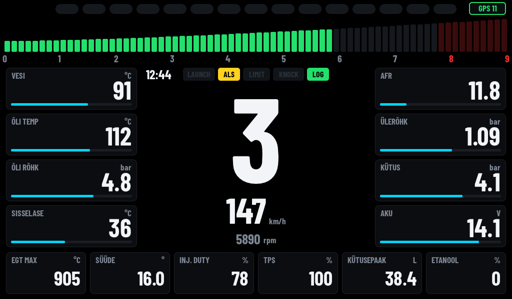 |  |
| **KIIRUS** | **RACE 2** |
| 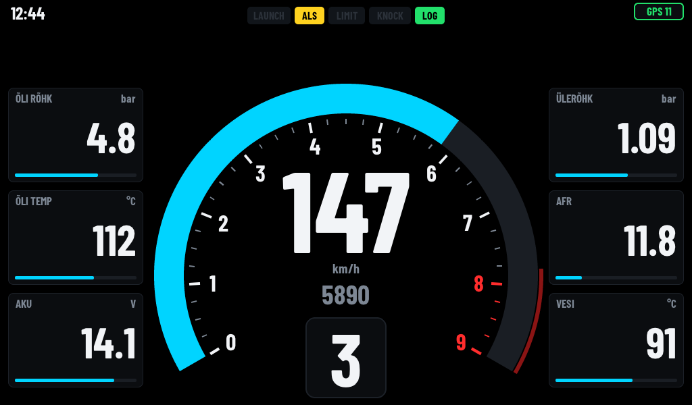 | 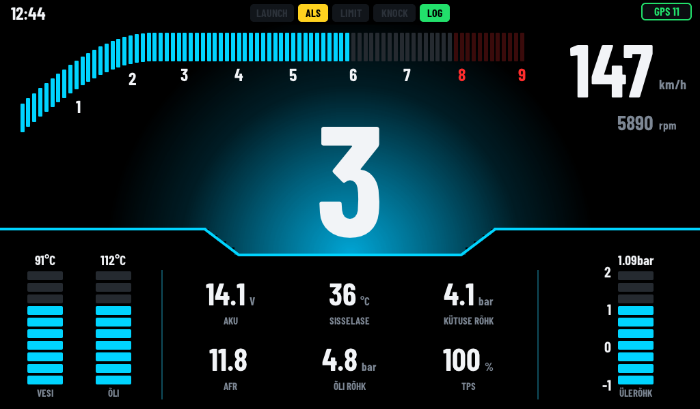 |
| **ANALOOG** | **ANALOOG** (tänavarežiim) |
| 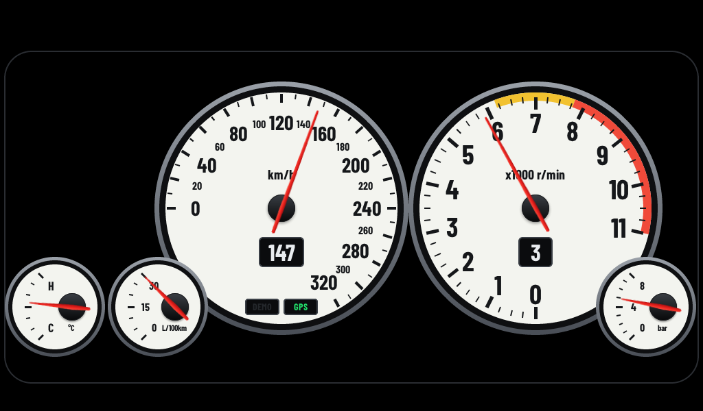 | 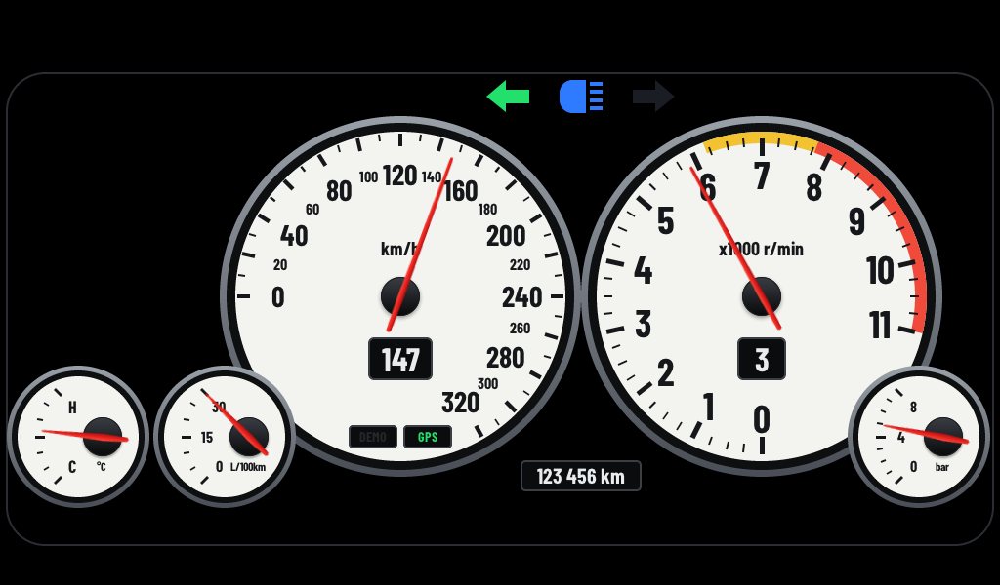 |
| **TÄNAV** (tänavarežiim) | **ANDMED** |
| 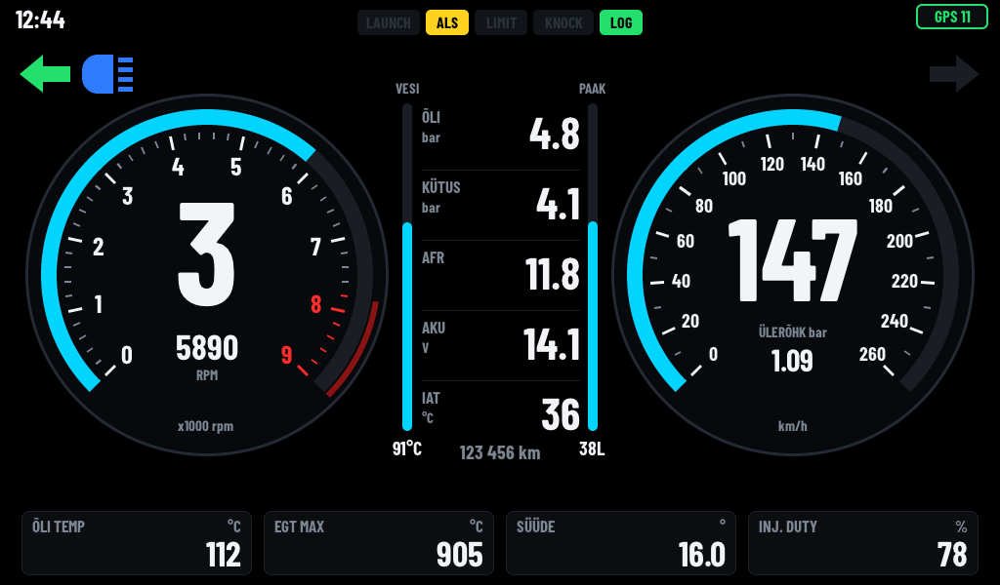 |  |

**GPS-iga** (vaated on nähtavad ainult siis, kui GPS on ühendatud):

| 0–100 | RING |
|---|---|
| 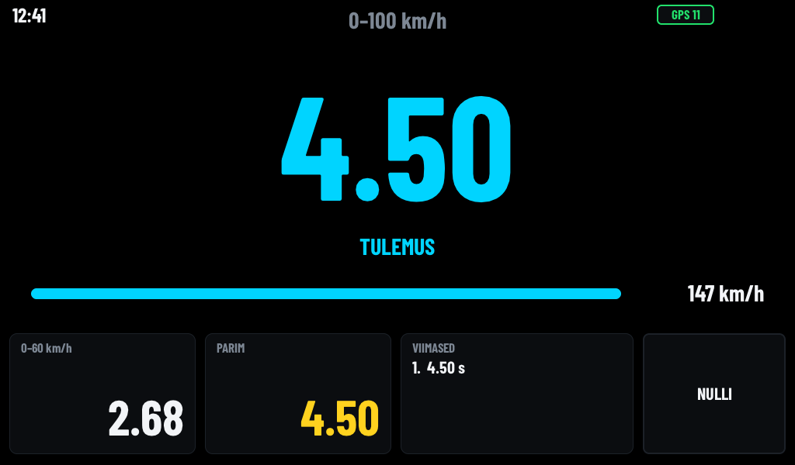 | 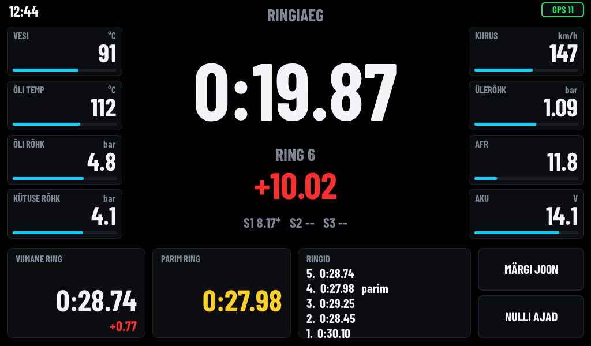 |
| **RADA** | |
| 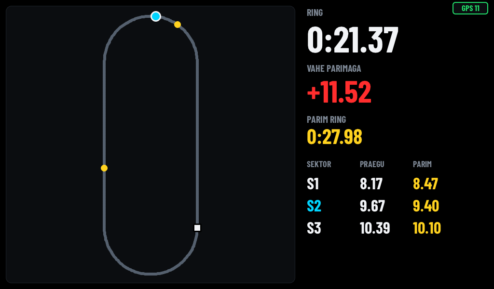 | |

**Seaded ja hoiatused:**

| SEADED (ECU nupud, seaded, sõit, hoiatused) | Suur hoiatus |
|---|---|
| 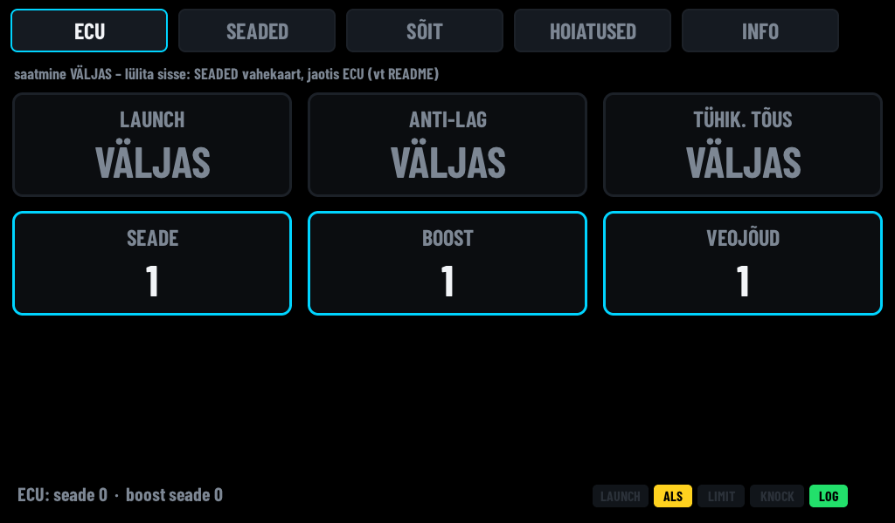 | 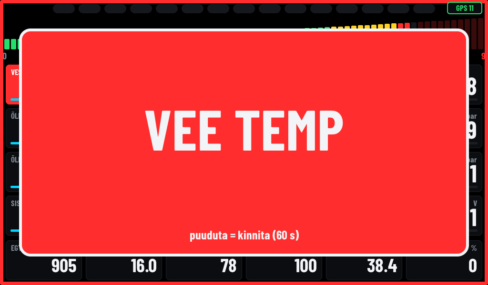 |

MaxxECU → CAN (500 kbit/s) → SN65HVD230 → ESP32-P4 TWAI → LVGL dash.
Käivitub umbes sekundiga; väljalülitamisel pole midagi, mis võiks rikki minna.

## Ühendused

Põhjalikumad juhendid:
- [MaxxECU CAN → SimplDash: ühendamise juhend](docs/CAN-uhendus.md) – ostunimekiri, ühendamine samm-sammult, MTune, kontroll.
- [Tänavarežiim: suunatuled, kaugtuled ja läbisõit](docs/tanavareziim.md) – optron, ühendamine, pinnid ([PC817 plaadi ühenduste joonis](docs/pc817-uhendus.svg)).
- [Nissan R33 Skyline GTS-t: originaal näidikupaneeli eemaldamine](docs/R33-GTS-t.md) – laadimine, kiiruse signaal, kütusepaak, ülevaatus.

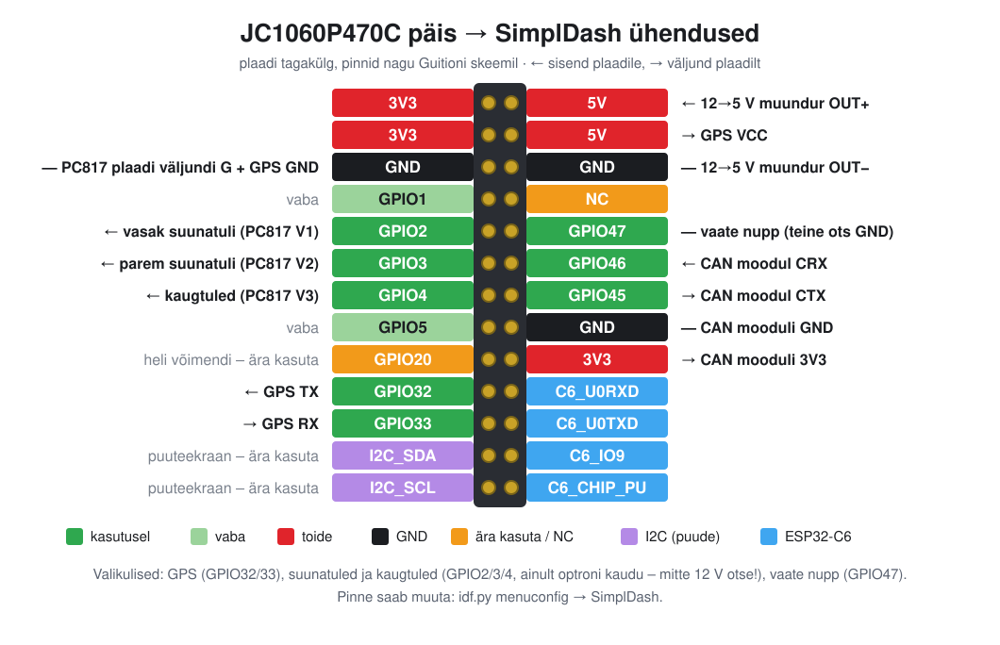

Plaadi päis (2 × 13 pinni). Vasak tulp ülevalt alla on L1–L13, parem tulp R1–R13, nagu joonisel:

| Pin | Signaal | Ühendus | |
|---|---|---|---|
| R1 | 5V | ← 12→5 V muunduri OUT+ | **toide** |
| R3 | GND | ← 12→5 V muunduri OUT− | **toide** |
| R6 | **GPIO46** (CAN RX) | ← SN65HVD230 **CRX** | **CAN** |
| R7 | **GPIO45** (CAN TX) | → SN65HVD230 **CTX** | **CAN** |
| R8 | GND | — SN65HVD230 **GND** | **CAN** |
| R9 | **3V3** | → SN65HVD230 **3V3** (mitte 5 V!) | **CAN** |
| R5 | GPIO47 | vaate nupp: nupp GPIO47 ja GND vahele | valikuline |
| R2 | 5V | → GPS mooduli VCC | valikuline: [GPS](#gps-valikuline) |
| L10 | GPIO32 | ← GPS mooduli **TX** | valikuline: GPS |
| L11 | GPIO33 | → GPS mooduli **RX** (10 Hz seadistus) | valikuline: GPS |
| L3 | GND | — PC817 plaadi väljundi G ja GPS-i GND | valikuline: [tänavarežiim](docs/tanavareziim.md) |
| L5 | GPIO2 | ← vasak suunatuli (PC817 plaadi V1) | valikuline: tänavarežiim |
| L6 | GPIO3 | ← parem suunatuli (PC817 plaadi V2) | valikuline: tänavarežiim |
| L7 | GPIO4 | ← kaugtuled (PC817 plaadi V3) | valikuline: tänavarežiim |

Vabad: GPIO1 (L4), GPIO5 (L8), 3V3 (L1, L2). **Ära kasuta:** GPIO20 (heli võimendi), I2C_SDA/SCL (puuteekraan), C6_* (Wi-Fi kiip), NC.

SN65HVD230 teine pool: **CANH** → MaxxECU **hall** juhe, **CANL** → MaxxECU **roosa** juhe.
Plaadi GND peab olema ühendatud ka auto/ECU massiga (muunduri kaudu).

Toide: 12 V süütevool → kaitse 3 A → 12 V → 5 V muundur (≥ 2 A, auto/24 V sisendiga) → päise 5V/GND.

> ⚠ Auto 12 V signaali (suunatuled, kaugtuled) **ei tohi** ühendada otse GPIO-sse – plaat talub 3,3 V.
> Vahele käib optron (4-kanaliline PC817 plaat, ostetakse eraldi), vt [tänavarežiim](docs/tanavareziim.md).

**microSD-kaart** käib plaadi TF-pessa (vt [SD-kaart](#sd-kaart-sõidulogi)). Wi-Fi on plaadil olemas (ESP32-C6), juhtmeid pole vaja.

> Pinnid on vaikimisi juba seadistatud nagu tabelis. Kui muudad ühendusi, muuda ka tarkvaras:
> `idf.py menuconfig` → **SimplDash** (CAN, vaate nupp, GPS, suunatuled, kaugtuled; `-1` = pole ühendatud).
>
> Plaadil kasutusel (ära vali): 0, 6–20, 23, 26–31, 34, 35, 39–44, 48–54.

**Terminaator:** MaxxECU CAN1-l on 120 Ω sees. Paljudel SN65HVD230 moodulitel on samuti
120 Ω peal – nii on buss mõlemast otsast lõpetatud. Mõõda CANH–CANL vahel (toide väljas): ~60 Ω = õige.

## MTune
CAN → Output protocol **MaxxECU Default 1.3**, CAN1 bitrate **500 kbit/s**.

## Valmis püsivara laadimine (ilma ESP-IDF-ita)
Iga [reliisi](https://github.com/1mreausta/SimplDash/releases) juures on kaks faili:

| Fail | Milleks |
|---|---|
| `simpldash-vX.Y.bin` | **terve mälupilt** – USB kaudu aadressile **0x0** (esimene kord, või kui midagi läks valesti) |
| `simpldash.bin` | ainult rakendus – **Wi-Fi uuenduseks** telefonist (vt [Püsivara uuendus Wi-Fi kaudu](#püsivara-uuendus-wi-fi-kaudu)) |

**USB kaudu:** ühenda plaat USB-C kaudu ja
- **brauseris:** ava https://espressif.github.io/esptool-js/ (Chrome/Edge), Connect → vali port,
  Flash Address `0x0`, vali fail `simpldash-vX.Y.bin` → Program; või
- **käsurealt:** `pip install esptool`, siis
  ```bash
  esptool --chip esp32p4 write-flash 0x0 simpldash-v0.5.bin
  ```

> **v0.3 või vanemalt v0.4-le: kindlasti USB kaudu, terve fail aadressile 0x0.** Versioonis 0.4 muutus välkmälu
> jaotus (kaks püsivara pesa Wi-Fi uuenduse jaoks), vanem versioon Wi-Fi uuendust ei oska. Edaspidi (0.4 → uuem)
> saab uuendada telefonist.

**NB:** terve faili laadimine USB kaudu kustutab ka püsimälu – **seaded, läbisõit, mootoritunnid, hoiatuste logi ja
salvestatud rada lähtestuvad**. Wi-Fi uuendus (`simpldash.bin`) jätab need alles. Kui pead hiljem USB kaudu
uuendama ja tahad läbisõitu säilitada, pane see enne kirja (SEADED → SÕIT) ja määra pärast telefonis uuesti.

Muudatuste nimekiri: [CHANGELOG.md](CHANGELOG.md).

## Esimene seadistus (kiirjuhend)
1. **Ühenda** CAN (vt [Ühendused](#ühendused)) ja soovi korral GPS; pane TF-pessa microSD (FAT32).
2. **MTune:** CAN output protocol *MaxxECU Default 1.3*, 500 kbit/s (vt [MTune](#mtune)).
3. **Laadi püsivara** USB kaudu (`simpldash-vX.Y.bin` → 0x0). GPS-i kasutamiseks pead püsivara ise kompileerima
   ja GPS-i pinnid valima (vt [GPS](#gps-valikuline)) – reliisifailis on GPS väljas.
4. **Süüde sisse:** logo, siis dash. Kui näed „ECU ÜHENDUS PUUDUB“, kontrolli CAN juhtmeid ja MTune'i.
5. **SEADED → INFO / DIAG:** kas ECU on „ühendatud“ (DIAG: „MaxxECU 22/22 kaadrit“), GPS-il asukoht ja ~10 Hz,
   SD-kaart „valmis“ / „logib“, Wi-Fi töötab. Kui midagi ei tööta, vt [Diagnostika](#diagnostika-seaded--diag).
6. **Muuda Wi-Fi parool:** telefon → võrk *SimplDash* (parool *simpldash*) → http://192.168.4.1 → Seaded → WI-FI.
7. **Seadista oma autole** (ekraanil SEADED või telefonis): hoiatuste piirid, õlirõhu kõver, shift-light,
   pihustite suurus ja silindrite arv (kütusekulu), ühikud. Telefonis Ülevaade → määra odomeeter.
8. **ECU nupud** (valikuline): seadista MTune'is CAN inputs ja lülita sisse SEADED → jaotis ECU (vt [MaxxECU](#maxxecu-lisakanalid-ja-nupud)).

## Ehitamine ja plaadile laadimine
```bash
cd firmware
source env.sh                 # laadib ESP-IDF 6.1 (paigaldatud ~/esp)
idf.py build
idf.py -p /dev/cu.usbmodem* flash monitor
```
Esimesel korral (uus arvuti või värske `git clone`): paigalda [ESP-IDF 6.1](https://docs.espressif.com/projects/esp-idf/en/latest/esp32p4/get-started/), siis
`idf.py set-target esp32p4 && idf.py bmgr -b jc1060p470_i_w_y && idf.py build`.

## GPS (valikuline)
Nt **Ebyte E108-GN04G-TTL** (TTL-variant, mitte -232/-485): toide 5 V, andmed 3,3 V UART-i kaudu.

| GPS moodul | Plaat |
|---|---|
| VCC | 5V |
| GND | GND |
| TX | GPIO32 (L10) → `SIMPLDASH_GPS_RX_GPIO` |
| RX (valikuline) | GPIO33 (L11) → `SIMPLDASH_GPS_TX_GPIO` |

Pinnid ja kiirus (vaikimisi 38400): `idf.py menuconfig` → SimplDash. Kui GPS-i pole ühendatud, ei juhtu midagi –
GPS-i vaated ja ikoon tulevad nähtavale alles siis, kui moodul saadab andmeid. GPS-i välja lülitamiseks: RX GPIO = `-1`.

**10 Hz:** ühenda ka mooduli **RX** juhe (`SIMPLDASH_GPS_TX_GPIO`). Siis seadistab dash mooduli igal käivitusel:
UART 115200 baudi, ainult RMC + GGA laused ja uuendussagedus `DASH_GPS_RATE_HZ` (vaikimisi 10 Hz).
Kuna mooduli kiip pole teada, saadetakse levinumate kiipide käsud (CASIC, MediaTek, Goke, Airoha) –
moodul eirab võõraid. Moodul leitakse ise ka siis, kui tema kiirus on teadmata (9600…230400).
**Tulemust näed SEADED → INFO** („GPS: … 10 Hz, 115200 baud“). Kui seal on 1 Hz, ei tundnud moodul käske ära.

GPS-iga lisandub:
- **kiiruse allikas** `DASH_SPEED_SOURCE` (`dash_config.h`): ECU, GPS või AUTO (GPS kui satelliidid olemas, muidu ECU);
- **GPS ikoon** (roheline = asukoht olemas, kollane = otsib) ja **kell** (Eesti aeg, suveaeg automaatselt);
- vaated **0–100** (kiirendusaeg, 0–60 vaheaeg, parim ja viimased), **RING** (ringiaja taimer:
  vajuta rajal start/finiš joonel *MÄRGI JOON*) ja **RADA**. Need vaated on nähtavad ainult siis, kui GPS on ühendatud.
- **vahe parima ringiga** (suur roheline/punane number RING ja RADA vaates): võrdleb sama kohta rajal parima ringiga;
- **sektorid** S1–S3: esimese täisringi järel jagatakse rada kolmeks, iga sektori aeg ja parim (\* = parim sektor);
- **RADA** vaates raja kaart parima ringi järgi, auto asukoht, start/finiš (valge) ja sektorite piirid (kollased 1, 2);
  nupud **MÄRGI START**, **SEKTORID** (piirid kaardil puudutusega) ja **AUTO**;
- rada (joon ja sektorid) **jäetakse meelde**: järgmine kord samal rajal (3 km raadiuses) algab ajavõtt ise
  esimesel joone ületamisel. *NULLI AJAD* kustutab ajad, *MÄRGI JOON* alustab uue rajaga.

**Rajapäeval (RING / RADA):**
1. Sõida start/finiš joonele, peatu või sõida aeglaselt sõidusuunas ja vajuta **MÄRGI START** (RADA vaates) või
   **MÄRGI JOON** (RING vaates) – joon salvestub sinu asukoha ja sõidusuuna järgi (laius ±25 m, `DASH_LAP_GATE_M`)
   ning esimene ring algab kohe.
2. Iga joone ületus samas suunas = uus ring (lühem kui 10 s ei loe – `DASH_LAP_MIN_S`).
3. Esimese ringi ajal joonistub RADA vaatesse GPS-i järgi raja tegelik kuju; ringi lõpus jagatakse rada
   automaatselt kolmeks võrdseks sektoriks (kollased täpid 1 ja 2 = S1 ja S2 lõpp).
4. **Sektorid käsitsi** (nt kurvide järgi): RADA vaates **SEKTORID** → kaardi äär läheb kollaseks → puuduta kaardil
   kohta, kus lõpeb S1, siis kohta, kus lõpeb S2 (piir läheb lähimasse raja punkti, mitte stardijoone kõrvale).
   *LOOBU* katkestab, **AUTO** paneb sektorid tagasi automaatseks. Sektorite muutmisel nullitakse sektoriajad ja
   käimasoleva ringi sektorid jäävad vahele. Sektorid jäetakse koos rajaga meelde.
5. Alates teisest ringist näed **vahet parima ringiga** samas kohas rajal: roheline −0.32 = oled kiirem,
   punane +0.45 = aeglasem. Parem ring saab uueks võrdluseks automaatselt.
6. Ringiajad ja sektorid kirjutatakse ka SD-kaardi logisse (veerud *Lap*, *Lap time s*).

Simulaatoris: nupud **GPS ühendatud** (G) ja **Kiirus: AUTO/ECU/GPS** (S); demo-auto sõidab ~2,3 km rajal (stardisirge, kurvid, juuspöörded, šikaan, S-kurvid).

## Kasutamine
- **Süüte sisselülitamisel** näidatakse 2 s SimplDashi logo; shift-light'id süttivad järjest (tulede test) ja
  dash heleneb nähtavale samamoodi nagu vaadete vahetusel (`DASH_BOOT_MS`, 0 = kohe dash).
  Logo pilt tehakse fondist: `python3 tools/logo/make_boot_logo.py` → `main/boot_logo.c`.
- **Libista vasakule / paremale** – järgmine / eelmine vaade (RACE → TÄNAV → KIIRUS → RACE 2 → ANALOOG → ANDMED → SEADED;
  GPS-iga lisaks 0–100, RING ja RADA). Vaateid saab peita: SEADED → VAATED.
  Vahetus on sujuv (tumeneb ja heleneb, 0,3 s – `DASH_PAGE_FADE_MS`, 0 = kohe). Vaate nimi näidatakse hetkeks all keskel; viimane vaade jäetakse meelde ka pärast väljalülitamist.
- **Füüsiline nupp** (valikuline, nt roolil) – järgmine vaade. Nupp GPIO ja GND vahele,
  seejärel `idf.py menuconfig` → SimplDash → *Vaate nupu GPIO*.
- **Lühike puudutus** (tühjal kohal, mitte nupul) – heledus 100 % → 50 % → 20 %
- **Hoia 3 s** – demorežiim sisse/välja (ülal paremal kollane „DEMO“). Käivitub alati päris režiimis.
- **„ECU ÜHENDUS PUUDUB“** – üle 1 s pole MaxxECU kaadreid tulnud.
- **ANDMED** vaates nupp **NULLI TIPUD** tühjendab min/max väärtused (tippe loetakse alati, ka teistes vaadetes).
- Hoiatused (riba + punane raam) töötavad kõigis vaadetes – vt [Hoiatused](#hoiatused).
- **SEADED** vaade (viimane vaade), vahekaardid:
  - **ECU** – nupud, mis saadavad MaxxECU-le käske (vt [MaxxECU](#maxxecu-lisakanalid-ja-nupud));
  - **SEADED** – piirid, õlirõhu kõver, shift-light, mootor, ühikud, logimine, Wi-Fi, ECU saatmine, vaadete peitmine.
    Ülal jaotiste kiirnupud (HOIATUSED, ÕLIRÕHK … VAATED), muutmine nuppudega − / +. Muudatused salvestatakse ise ~2 s
    pärast; tärniga/„rakendub pärast taaskäivitust“ seaded (ühikud, Wi-Fi) hakkavad kehtima pärast süüte välja-sisse;
  - **SÕIT** – läbisõit, mootoritunnid, reis (km, kütus, keskmine ja hetke kulu, sõiduaeg, paagis); *NULLI REIS*;
  - **HOIATUSED** – hoiatuste logi; *KUSTUTA*;
  - **INFO** – ECU, GPS (satelliidid, Hz, baud), SD-kaart, Wi-Fi, versioon; *DEMO*; *VAIKESEADED* (2 vajutust 3 s jooksul);
  - **DIAG** – paigalduse diagnostika (vt allpool).
  SEADED vaates ei kata „ECU ÜHENDUS PUUDUB“ ekraani – seadeid ja diagnostikat saab vaadata ka ilma ECU-ta.

## Diagnostika (SEADED → DIAG)
Esimesel paigaldusel ja vigade otsimisel. Värskeneb 2 korda sekundis.

- **CAN:** „MaxxECU N/22 kaadrit“ (roheline = kõik tulevad), kaadreid sekundis, bus-off ja kadunud kaadrid;
  kontrolleri olek ja veaarvurid; tabelis iga CAN ID sagedus (Hz) – MaxxECU 0x520–0x528 peaks olema ~50 Hz,
  0x530–0x542 ~10 Hz, „–“ = kaader puudub. Ka teised siinil olevad ID-d on näha (nt kohandatud kaadrid).
- **GPS:** olek, satelliidid, HDOP, Hz, baud, korrektsed/vigased laused ja 5 viimast toorlauset.
- **SD-kaart:** maht, vaba ruum ja **KIIRUSE TEST** (kirjutab 256 kB): alla ~200 kB/s on 20 Hz logi jaoks aeglane.
- **Süsteem:** tööaeg, vaba mälu, viimase käivituse põhjus (nt „toitepinge langus“ = toide nõrk või katkendlik).

| Näed | Tõenäoline põhjus |
|---|---|
| MaxxECU 0/22, kokku 0 kaadrit, kontroller „aktiivne“ | MTune'is CAN väljund väljas või vale CAN (CAN1/CAN2) |
| 0/22, kontroller „PASSIIVNE“ / „BUS-OFF“, siini vigu kasvab | CANH/CANL vahetuses, vale bitikiirus (500 kbit/s?), terminaator puudu (mõõda ~60 Ω), GND puudu |
| osa kaadreid puudub | MTune'is valitud vanem protokolli versioon (vali Default 1.3) |
| GPS „andmeid ei tule“ | mooduli TX juhe, vale GPIO menuconfigis, toide |
| GPS lausetel „[VIGA]“ | vale UART kiirus või häiritud juhe |
| GPS 1 Hz, kuigi soov 10 | mooduli RX juhe puudu või moodul ei tunne seadistuskäske (vt GPS) |
| kadunud > 0 | dash ei jõua kaadreid töödelda (palju teisi seadmeid siinil) – anna teada |

## Hoiatused
- Piirid (`DASH_WARNINGS`) on vaikeväärtused – muuda neid **SEADED** vaates või telefonist. Piir peab olema
  ületatud vähemalt 0,3 s (lühike piik ei anna hoiatust).
- **Õlirõhk pöörete järgi** (`DASH_OIL_CURVE`): miinimum on kõver (nt 0,7 bar @ 800 rpm … 2,5 bar @ 6000 rpm),
  mitte üks number – tühikäigul madal rõhk on normaalne, suurtel pööretel mitte. Punkte saab muuta SEADED vaates.
- **Suur hoiatus üle ekraani** (vilgub punaselt) ohtlike asjade puhul: vee temp, õlirõhk, kütuse rõhk ja **KNOCK**
  (MaxxECU olekulipp; `full = 1` tabelis). Puudutus = kinnita – sama hoiatus ei kata ekraani 60 s (riba jääb).
  ECU veakood (MaxxECU 0x542) näidatakse ribal „ECU VIGA nr“.
- **Hoiatuste logi:** viimased 40 hoiatust (aeg GPS-ist või mootoritunnid, väärtus, piir, pöörded) jäävad meelde
  ka pärast väljalülitamist – SEADED → HOIATUSED või telefonist.
- **Hoiatuse väljalülitamine:** SEADED → HOIATUSED, vajuta − kuni „VÄLJAS“ (telefonis tühjenda väli).
  Suure täisekraani hoiatuse saab üldse välja lülitada (*Suur hoiatus üle ekraani*), riba ja raam jäävad.

## SD-kaart (sõidulogi)
Pane plaadi TF-pessa microSD (FAT32). Iga sõit salvestub eraldi faili `logs/AAAAKKPP_ttmmss.csv` (GPS-i aeg UTC;
ilma GPS-ita `LOG00001.csv` …): aeg, GPS (asukoht, kiirus, suund), ~27 ECU kanalit (`DASH_LOG_CHANNELS`),
olekulipud, aktiivsed hoiatused ja ringiajad. Vaikimisi 20 rida sekundis, kui mootor töötab (SEADED → LOGIMINE:
väljas / mootor töötab / alati, sagedus). Fail suletakse 10 s pärast mootori seiskumist; kettale kirjutatakse iga 2 s.
CSV avab Excel, Google Sheets, RaceChrono (import), MegaLogViewer jt. Faile saab alla laadida ka telefoniga.

- Kaart: microSD, **FAT32** (kuni 32 GB on kindlam). Kaardi võib panna ka hiljem – dash otsib seda iga 10 s.
- Logis on väärtused alati SI-ühikutes (°C, kPa, km/h), sõltumata ekraani ühikuseadest; veergude pealkirjad on inglise keeles.
- Tund sõitu 20 Hz juures on umbes 25 MB. Vanu faile saad kustutada telefonist (Logid) või arvutis.
- Kas logib: SEADED → INFO („logib: fail (N rida)“). „KIRJUTUSVIGA“ = kaart täis või vigane.
- Voolu katkemisel kaob kõige rohkem viimased ~2 s.

## Wi-Fi ja telefoni veebileht
Dash teeb oma Wi-Fi võrgu (plaadi ESP32-C6 kiip): vaikimisi **SimplDash**, parool **simpldash**
(muuda kindlasti – SEADED või veebilehel). Ühenda telefon selle võrguga ja ava **http://192.168.4.1**:
- **Ülevaade** – põhinäidud, GPS, SD, läbisõit, reis (nulli reis, määra odomeeter);
- **Seaded** – kõik SEADED vaate seaded + Wi-Fi nimi ja parool;
- **Logid** – CSV-failide allalaadimine ja kustutamine;
- **Hoiatused** – hoiatuste logi;
- **Uuendus** – uus püsivara Wi-Fi kaudu (vt allpool).

**Ühendamine:** telefoni Wi-Fi seadetes vali võrk *SimplDash* ja sisesta parool. Telefon võib öelda
„internetiühendus puudub“ – see on õige (dashil internetti pole), jää võrku ja ava brauseris **http://192.168.4.1**
(kirjuta `http://` ette). Lehte saab avada ka mitmest telefonist korraga (kuni 4 seadet).

Wi-Fi saab välja lülitada (SEADED → WI-FI). Võrgu nime ja parooli muutmine rakendub pärast taaskäivitust.
Kui parool on lühem kui 8 märki, on võrk parooli**ta** – ära nii tee.

Simulaatoris on sama leht aadressil http://localhost:8090/web (Wi-Fi-t ja püsivara uuendust seal pole).

### Püsivara uuendus Wi-Fi kaudu
1. Laadi telefoni [reliisist](https://github.com/1mreausta/SimplDash/releases) fail **`simpldash.bin`**
   (mitte `simpldash-vX.Y.bin` – see on terve mälupilt USB jaoks).
2. Ühenda telefon dashi Wi-Fi-ga, ava http://192.168.4.1 → **Uuendus** → vali fail → **Laadi üles**.
3. Oota, kuni riba on täis ja tuleb teade „Valmis“ – dash taaskäivitub uue versiooniga (~10 s). Ära lülita süüdet
   välja enne taaskäivitust.
4. Kontrolli versiooni: käivitusekraanil või SEADED → INFO.

Uus püsivara kirjutatakse teise mälupessa – kui üleslaadimine katkeb või fail on vale, jääb vana versioon tööle.
Seaded, läbisõit, hoiatuste logi ja SD-kaardi logid jäävad alles.

### Kui Wi-Fi ei tööta
- SEADED → INFO → Wi-Fi rida: „väljas“ = lülita sisse SEADED → WI-FI ja taaskäivita;
  „viga: …“ = plaadi ESP32-C6 ei vastanud (vt [Teadaolevad piirangud](#teadaolevad-piirangud)).
- Võrku ei näe: oota pärast süüte sisselülitamist ~5 s; kontrolli võrgu nime SEADED → WI-FI all.
- Leht ei avane: kontrolli, et telefon on endiselt *SimplDash* võrgus (mõni telefon vahetab ise võrku, kui internetti
  pole – lülita mobiilne andmeside ajutiselt välja) ja aadress algab `http://`.

## MaxxECU: lisakanalid ja nupud
**Lisakanalid (CAN sisse):** kanalid, mida Default protokoll ei saada (nt veojõukontrolli aste, sihtrõhk):
MTune → CAN → **CAN outputs** → uus „User defined“ kaader, siis kirjelda sama kaader `DASH_CUSTOM_CAN`
tabelis (ID, bait, tüüp, korrutaja). Kuni 8 kanalit → `SIG_CUST1…8`, mida saab panna ükskõik millisesse näidikusse.

**Nupud (dash → ECU):** **SEADED** vaate esimesel vahekaardil **ECU** on nupud (`DASH_ECU_BUTTONS`): lülitid (LAUNCH, ANTI-LAG),
hoitav nupp TÜHIK. TÕUS (tühikäigu tõstmine – bitt on 1 ainult vajutuse ajal) ja valikud (SEADE 1–4, BOOST 1–4, VEOJÕUD 1–9). Dash saadab nende oleku
10 korda sekundis ühes kaadris (vaikimisi ID **0x5F0** = 1520):

| Bait | Sisu |
|---|---|
| 0 | lülitid: bit 0 LAUNCH, bit 1 ANTI-LAG, bit 3 TÜHIK. TÕUS |
| 1 | SEADE (1–4) |
| 2 | VEOJÕUD (1–9) |
| 3 | BOOST (1–4) |
| 7 | loendur (muutub iga kaadriga) |

MTune → CAN → **CAN inputs**: „CAN message input“, ID **1520**, Little endian, **Timeout** sees (nt 0,5 s).
Lüliti: ByteOffset 0, Type 8 bit, *bit mask* = 1 (bit 0), 2 (bit 1), 8 (bit 3) …, mode *Momentary*,
*input function* = soovitud funktsioon. Valik: ByteOffset 1/2/3, Type 8 bit → User CAN input, mida kasutad
nt seadistuse (tune) valikus, boost-tabeli valikus või veojõu tabelis. Lõpuks lülita dashis sisse **SEADED → jaotis ECU → Nupud saadavad ECU-le**
(vaikimisi väljas, et dash midagi ootamatult ei saadaks). ECU vahekaardi all on ECU tagasiside (aktiivne seade, lipud).
> Testi esmalt seisva autoga: MTune → RealTime Data → User CAN inputs näitab, mida dash saadab.

Nuppude oleku jätab dash meelde (ka pärast väljalülitamist) ja saadab selle kohe käivitusel – LAUNCH, mis oli
sees, on ka järgmisel korral sees. ECU vahekaardi ülaosas on näha saadetav kaader (8 baiti hex) ja „VIGA“, kui
saatmine ei õnnestu (nt CAN on listen-only režiimis). Nuppe ja baite saab muuta `DASH_ECU_BUTTONS` tabelis
(kuni 12 nuppu: lüliti, hoitav nupp või valik 1…max).

## Seadistamine
Kõik näidikud, hoiatuspiirid, shift-lightid ja iga vaate näidikud:
[`main/dash_config.h`](main/dash_config.h) (`DASH_TILES_*` = RACE, `DASH_GAUGES_*` = TÄNAV,
`DASH_SWEEP_*` = KIIRUS, `DASH_STREET_*` = RACE 2, `DASH_CLASSIC_*` / `DASH_INJ_CC_MIN` / `DASH_CYLINDERS` = ANALOOG,
`DASH_DATA_ROWS` = ANDMED).
Suur osa seadeid (piirid, õlirõhu kõver, shift-light, pihustid, ühikud °C/°F ja bar/psi, ajavöönd, logimine,
Wi-Fi, vaadete peitmine) on muudetavad ka ekraanil (**SEADED**) ja telefonist – siis pole vaja püsivara
uuesti laadida. `dash_config.h` väärtused on vaikeväärtused (SEADED → telefonis *Vaikeseaded* taastab need).
Ühikud (°F, psi) kehtivad numbritele ja ribadele; osutitega kellade skaalad (ANALOOG, TÄNAV kaared)
jäävad alati meetrilisteks (°C, bar, km/h).
CAN-pinnid, bitikiirus, listen-only, suunatulede ja kaugtulede pinnid: `idf.py menuconfig` → SimplDash.
Režiim AINULT RADA / TÄNAV: SEADED → VAATED → Režiim (vt [tänavarežiim](docs/tanavareziim.md)).

## Simulaator arvutis (interaktiivne, ilma plaadita)
```bash
tools/sim/run.sh              # siis ava brauseris http://localhost:8090
```
Sama C-kood (kõik vaated, dekooder, demo sõidumudel) jookseb Macis ja ekraan on brauseris.
- **hiir = puuteekraan:** libista vaadete vahel, klõps = heledus, hoia 3 s = demo
- **nupud / klahvid:** ← → vaade · **D** demo sõit · **C** katkesta CAN (näed „ECU ÜHENDUS PUUDUB“) ·
  **H** vesi kuumeneb üle (näed hoiatust) · **K** knock (suur hoiatus) · **B** käivitusekraan (näidatakse ka lehe avamisel) ·
  **T** suunatuli (väljas → vasak → parem → ohutuled) · **L** kaugtuled · **M** režiim AINULT RADA / TÄNAV
- **telefoni veebileht:** http://localhost:8090/web (sama mis plaadil Wi-Fi kaudu)
- seaded, läbisõit ja hoiatuste logi jäävad meelde kaustas `tools/sim/data/`, „SD-kaardi“ logifailid on
  `tools/sim/data/sdcard/logs/`. Kõik nulli: kustuta kaust `tools/sim/data`.
- peata: **Ctrl+C** terminalis. Muu port: `tools/sim/run.sh 8091`

Vajab ainult macOS-i ja clang-i (Xcode Command Line Tools), lisateeke pole vaja.

## Veebisimulaator (WebAssembly)
Sama kood kompileeritakse WebAssembly'ks ja avaldatakse GitHub Pages'is:
**https://1mreausta.github.io/SimplDash/** (kõik jookseb brauseris, serverit pole).
```bash
source ~/esp/tools/emsdk/emsdk_env.sh   # Emscripten
tools/web/build.sh                      # → tools/web/dist/ (index.html, simpldash.js, simpldash.wasm)
tools/web/deploy.sh                     # kompileerib ja avaldab gh-pages harusse
```

## Testid arvutis
```bash
tools/test/run.sh             # dekooder, õlirõhu kõver, ringi joon, veebilehe seadete sisend, sildi tekst
```
Kasutab sama koodi nagu plaat (vajab LVGL-i objektifaile – käivita enne korra `tools/preview/build.sh`).

## Eelvaade arvutis (ilma plaadita)
```bash
tools/preview/build.sh        # teeb pildid tools/preview/out/*.png
```
Joonistab kõik vaated, ka hoiatusega. Kasutab sama UI koodi – muuda disaini ja vaata tulemust enne plaadile laadimist.

## Teadaolevad piirangud
- **Plaadil testimata** (töötab simulaatoris ja kompileerub): Wi-Fi ja püsivara uuendus Wi-Fi kaudu, SD-kaardi logi,
  GPS mooduli 10 Hz seadistus, nuppude saatmine ECU-le. Esimesel kasutamisel jälgi `idf.py monitor` väljundit.
- **Wi-Fi** vajab, et plaadi ESP32-C6-l oleks *esp-hosted* püsivara, mis sobib selle versiooniga (Guition saadab
  tavaliselt kaasa). Kui SEADED → INFO näitab Wi-Fi viga, vajab C6 uuendust.
- **GPS 10 Hz:** mooduli kiip pole teada – kui INFO näitab 1 Hz, ei tunne moodul saadetud käske; ringiajad töötavad
  ka siis, aga väiksema täpsusega.
- Reliisifailis on GPS väljas (pinnid tuleb valida ja püsivara ise kompileerida).
- Kütusekulu on arvutatud pihustite töötsüklist – täpsus sõltub pihusti suuruse seadest ja kütuse rõhust.

## Failid
| Fail | Sisu |
|---|---|
| `main/maxxecu.c` | MaxxECU Default 1.2/1.3 protokolli dekooder |
| `main/can_rx.c` | TWAI (CAN) vastuvõtt, bus-off taastamine |
| `main/dash_ui.c` | vaadete vahetus, puudutused, hoiatused |
| `main/dash_common.c` | ühised vidinad (näidiku-plaat, olekulipud, fondid) |
| `main/page_*.c` | vaated: race, gauges (TÄNAV), sweep (KIIRUS), street (RACE 2), classic (ANALOOG), accel (0–100), lap (RING), track (RADA), data (ANDMED), settings (SEADED); page_ecu.c = SEADED vaate ECU vahekaart |
| `main/settings.c`, `main/store.c` | ekraanil/telefonis muudetavad seaded ja püsimälu (NVS) |
| `main/alarms.c` | hoiatused, õlirõhu kõver, ECU olekuhoiatused, hoiatuste logi |
| `main/stats.c` | läbisõit, mootoritunnid, reis ja kütusekulu |
| `main/logger.c` | sõidulogi SD-kaardile (CSV) |
| `main/lap_core.c` | ringiajad, sektorid, vahe parima ringiga, raja kuju |
| `main/diag.c` | diagnostika (CAN ID-d ja sagedused, CAN vead, GPS toorlaused, süsteem) |
| `main/lamps.c` | suunatulede ja kaugtulede sisendid (GPIO, tänavarežiim) |
| `main/can_ecu.c` | ECU nupud (SEADED → ECU) → CAN-kaader MaxxECU-le |
| `main/wifi_web.c`, `main/web_api.c` | Wi-Fi pääsupunkt, veebileht, püsivara uuendus |
| `tools/webpage/` | telefoni veebilehe HTML (`gen.py` → `main/web_page.c`) |
| `main/demo.c` | demorežiimi sõidumudel |
| `main/dash_config.h` | **kõik seaded** |
| `main/fonts/` | Barlow Condensed (SIL OFL litsents) |
| `docs/logo.svg`, `docs/icon.svg` | logo (sõnamärk) ja ikoon |
| `main/boot_logo.c`, `tools/logo/` | käivitusekraani logo ja selle generaator |

## Litsents
Kood: MIT – vt [LICENSE](LICENSE). Font Barlow Condensed: SIL Open Font License 1.1 ([main/fonts/OFL.txt](main/fonts/OFL.txt)).

SimplDash ei ole MaxxECU-ga seotud ega nende poolt heaks kiidetud; MaxxECU on oma omaniku kaubamärk.

