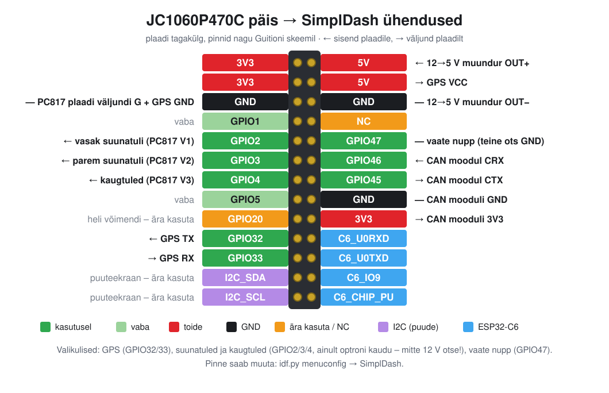

# MaxxECU CAN → SimplDash: ühendamise juhend

Juhend selle kohta, mida osta ja kuidas ühendada, et SimplDash saaks MaxxECU-lt andmed CAN-siini kaudu.
Lühike versioon on README jaotises [Ühendused](../README.md#ühendused).

```
auto 12 V (süüde) ─ kaitse ─ 12→5 V muundur ─ 5 V/GND ─┐
                                                     ├─ JC1060P470C plaat ─ 3V3/GND/GPIO45/GPIO46 ─ SN65HVD230
MaxxECU CAN1: CANH (hall) / CANL (roosa) ── keerdpaar ──────────────────────────────────────────── CANH / CANL
```

> **NB:** MaxxECU juhtmete värvid ja pinnid kontrolli oma ECU mudeli (Street / Sport / Race / PRO) pinout'ist
> MaxxECU dokumentatsioonis.

## 1. Ostunimekiri

| # | Mis | Märkus | Umbes |
|---|---|---|---|
| 1 | **Guition JC1060P470C** (ESP32-P4, 7") | dash ise | – |
| 2 | **SN65HVD230 CAN moodul** (3,3 V) | nt Waveshare SN65HVD230 CAN Board; 120 Ω terminaator peal. **Mitte** MCP2515 ega 5 V TJA1050 moodul | 3–10 € |
| 3 | **12 V → 5 V muundur (buck)**, ≥ 2 A (parem 3 A) | sisend vähemalt kuni 24 V (auto pingepiigid), soovitavalt veekindel / auto jaoks mõeldud | 5–15 € |
| 4 | **Kaitsmepesa + 3 A kaitse** | juhtmesse paigaldatav (inline), 12 V toite algusesse | 2–5 € |
| 5 | **Keerdpaarjuhe CAN-i jaoks** | 2-soonega, 0,25–0,5 mm², soovitavalt varjestatud; pikkus ECU → dash + varu | 1–3 €/m |
| 6 | **Toitejuhe** 0,5–0,75 mm² (punane + must) | süütevoolu (IGN) juhtmest muundurini | – |
| 7 | **Lintkaabel FC–FC, 2×13 (26P), 2,54 mm**, 10–20 cm | mõlemas otsas **emane** pistik (nt „2.54mm FC 26 Pin Gray Flat Ribbon Cable … For DC3 IDC Box Header“, 2x13Pin); mitte „male to female“ | 1–3 € |
| 8 | **IDC26 klemmimoodul** vedruklemmidega | nt **ENMG EXTB-C26M-42D** (76,5 × 48,5 × 48 mm) või „IDC26 2x13 Male Header Breakout Board … Spring Terminal Block“; isane 2×13 ümbrisega pistik + 26 klemmi, DIN-liistule või kruvidega | 10–12 € |
| 9 | Kahanevad sukad, jootetina, otsahülsid (0,25–0,5 mm²) | hülsid juhtmeotstele vedruklemmide jaoks | – |
| 10 | **Multimeeter** | takistuse ja pinge mõõtmiseks | – |
| 11 | **USB-C kaabel** (andmetega) | püsivara esmakordseks laadimiseks | – |
| 12 | *Valikuline:* microSD (FAT32), GPS moodul, nupp, 4-kanaliline PC817 plaat (tänavarežiim) | vt README ja [tänavarežiim](tanavareziim.md) | – |

Lintkaabel (7) ja klemmimoodul (8) on kõigi päise ühenduste jaoks (toide, CAN, GPS, nupp, suunatuled) – iga juhe läheb
mooduli klemmi, mitte otse plaadi pinnile. Odavam, aga autos vähem kindel variant: emased Dupont juhtmed otse päisele
(kinnita kuumliimiga).

Kui MaxxECU juhtmestikus pole CAN-juhtmeid välja toodud, on vaja ka ECU pistiku klemme (vastavalt ECU mudelile)
või MaxxECU CAN-juhtmestikku.

## 2. Tööriistad
Jootekolb, juhtmekoorija, klemmitangid, multimeeter, sülearvuti MTune'iga, USB kaabel ECU jaoks.

## 3. Ühendamine

**Enne alustamist ühenda aku miinusklemm lahti.**

### 3.0 Plaadi päis → lintkaabel → klemmimoodul
1. Lintkaabli **punane triip = pinn 1**. Pane kaabli üks ots plaadi päisele, teine klemmimooduli pistikusse.
   Mooduli pistik on ümbrisega (lõikega), nii et seal saab kaabel minna ainult ühtpidi.
2. **Enne millegi ühendamist** (dash USB toitel, muu ühendamata) mõõda multimeetriga, millisesse **mooduli klemmi**
   jõuab iga plaadi päise pinn, ja täida tabel. Kõige tähtsam: 3V3 (~3,3 V), 5V (~5 V) ja GND (0 V, takistus
   GND-ga ~0 Ω). Kui 5V ja 3V3 tulevad valedesse klemmidesse, on kaabel plaadi otsas teistpidi – keera ümber.

| Plaadi päis | Signaal | Mooduli klemm (mõõda ja kirjuta) |
|---|---|---|
| R1 | 5V ← muunduri OUT+ | |
| R3 | GND ← muunduri OUT− | |
| R6 | GPIO46 ← CAN CRX | |
| R7 | GPIO45 → CAN CTX | |
| R8 | GND — CAN GND | |
| R9 | 3V3 → CAN 3V3 | |
| R5 | GPIO47 — vaate nupp | |
| R2 | 5V → GPS VCC | |
| L10 | GPIO32 ← GPS TX | |
| L11 | GPIO33 → GPS RX | |
| L3 | GND — PC817 väljundi G, GPS GND | |
| L5 | GPIO2 ← PC817 V1 (vasak) | |
| L6 | GPIO3 ← PC817 V2 (parem) | |
| L7 | GPIO4 ← PC817 V3 (kaugtuled) | |

3. Edaspidi (3.1, 3.2 ja teised juhendid) tähendab „plaadi päise R1“ jne seda **mooduli klemmi**, mis tabelis R1 kõrval on.
4. Lintkaabel ja moodul kinnita nii, et kaabel ei rippuks (side või kuumliim pistiku juures) – vibratsioon.

### 3.1 Toide
1. Leia **süütevoolu** juhe (12 V ainult süüde sees, IGN/ACC). Püsiv 12 V tühjendaks seisva auto aku.
2. 12 V → **kaitse (3 A)** → muunduri **IN+**. Muunduri **IN−** → kere mass (sama punkt või lähedal ECU massile).
3. Enne plaadi ühendamist: süüde sisse, mõõda muunduri väljundis **5,0–5,2 V**. Süüde välja.
4. Muunduri **OUT+** → plaadi päise **R1 (5V)**, **OUT−** → **R3 (GND)**.

### 3.2 CAN moodul plaadile
| Plaadi päis | → | SN65HVD230 |
|---|---|---|
| R9 **3V3** | → | **3V3** (mitte 5 V!) |
| R8 **GND** | — | **GND** |
| R7 **GPIO45** (CAN TX) | → | **CTX** (TX / D) |
| R6 **GPIO46** (CAN RX) | ← | **CRX** (RX / R) |

R = plaadi päise parem tulp ülevalt alla (R1–R13), vt joonist:



### 3.3 CAN-siin
1. SN65HVD230 **CANH** → MaxxECU CAN1 **CANH** (hall). **CANL** → MaxxECU CAN1 **CANL** (roosa).
2. Kasuta **keerdpaari** (vähemalt 1 keerd 2–3 cm kohta). Hoia CAN-juhe eemal süütepoolidest ja süüteküünla juhtmetest.
3. Varjestatud juhtme korral ühenda varjestus massiga **ainult ühest otsast** (ECU poolt).
4. Dashi ja ECU mass peavad olema ühised (sama kere / sama massipunkt).

### 3.4 Terminaator (120 Ω)
CAN-siin vajab mõlemas otsas 120 Ω takistit. MaxxECU CAN1-l on see sees, SN65HVD230 moodulil tavaliselt samuti.

**Kontroll:** toide väljas, mõõda CANH ja CANL vahel:
- **~60 Ω** → õige (kaks 120 Ω paralleelis);
- **~120 Ω** → üks terminaator puudu (lisa 120 Ω takisti dashi otsa CANH–CANL vahele);
- **~40 Ω või vähem** → terminaatoreid on liiga palju (eemalda mooduli oma, kui siinil on veel seadmeid).

## 4. Püsivara
Laadi plaadile `simpldash-vX.bin` (README → *Valmis püsivara laadimine*). Kontrolli ilma autota USB toitel:
logo, siis dash ja „ECU ÜHENDUS PUUDUB“ → plaat töötab.

## 5. MTune seaded
1. Ühenda sülearvuti ECU-ga, ava MTune.
2. **CAN** → CAN1 bitrate **500 kbit/s**.
3. **Output protocol: MaxxECU Default 1.3** (vanem versioon = osa andmeid puudub).
4. Salvesta ECU-sse (Write / Burn).

## 6. Esimene käivitus ja kontroll
1. Ühenda aku, süüde sisse (mootorit pole vaja käivitada).
2. „ECU ÜHENDUS PUUDUB“ peab kaduma ja näidud tulevad ECU-lt (nt vee temp, aku pinge).
3. **SEADED → DIAG**: „MaxxECU 22/22 kaadrit“ roheline, kontroller „aktiivne“, vigu ei kasva;
   0x520–0x528 umbes 50 Hz.
4. Võrdle paari näitu MTune'i RealTime Data'ga (pöörded, vee temp, aku pinge).
5. Seadista SEADED vaates piirid ja ühikud.

## 7. Kui ei tööta

| Sümptom | Põhjus |
|---|---|
| Ekraan ei sütti | 5 V puudub / muundur valesti / kaitse läbi |
| Plaat taaskäivitub (DIAG → käivituse põhjus „toitepinge langus“) | muundur liiga nõrk, halb mass, käivitamisel pinge langus |
| DIAG: 0/22, kontroller „aktiivne“, kaadreid 0 | MTune'is CAN väljund väljas või vale CAN (CAN1/CAN2) |
| DIAG: „PASSIIVNE“ / „BUS-OFF“, vigu kasvab | CANH/CANL vahetuses, vale bitikiirus, terminaator puudu (mõõda ~60 Ω), ühine mass puudu, CTX/CRX vahetuses |
| Osa näite puudub | MTune'is vanem protokolli versioon – vali Default 1.3 |
| Näidud hüplevad / aeg-ajalt kaovad | CAN-juhe pole keerdpaar või käib süüte lähedalt, halb ühendus |

Lisa: README jaotis [Diagnostika](../README.md#diagnostika-seaded--diag).
