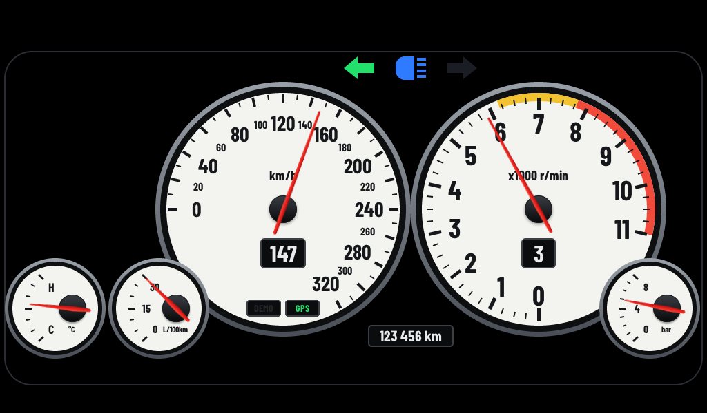
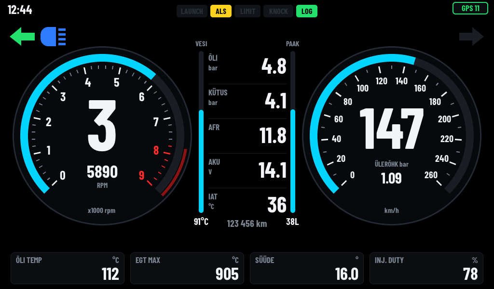
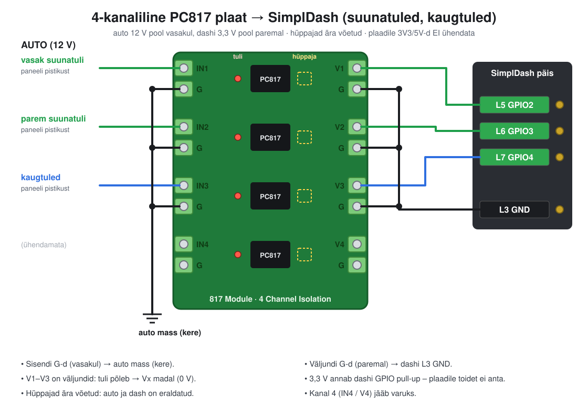
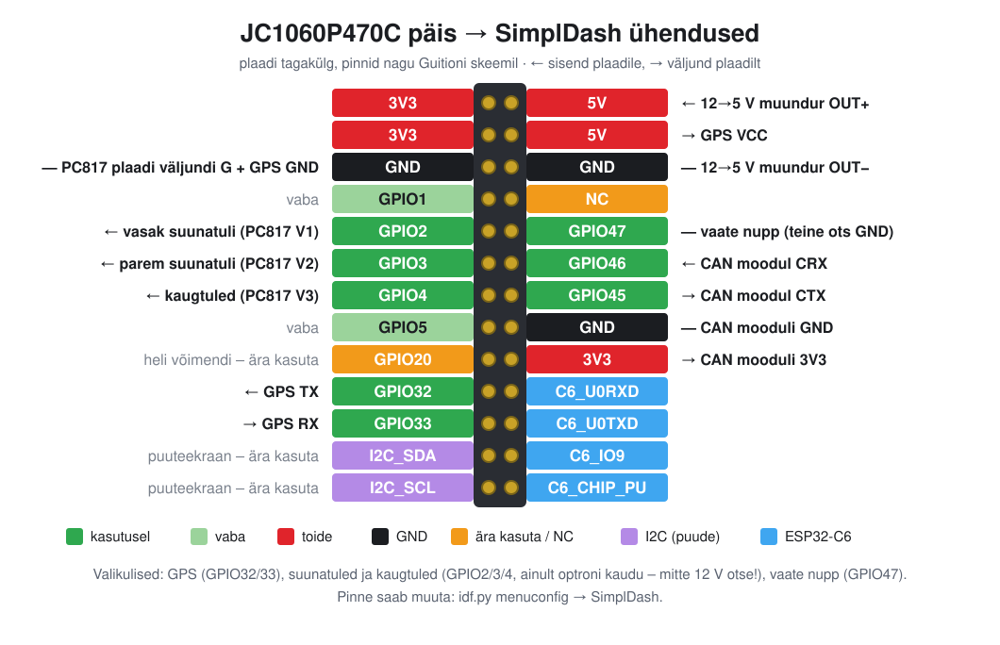

# Tänavarežiim: suunatuled, kaugtuled ja läbisõit

**SEADED → SEADED → VAATED → Režiim** (või telefoni veebilehel):
- **AINULT RADA** (vaikimisi): vaated on samad nagu varem.
- **TÄNAV**: ANALOOG ja TÄNAV vaates on lisaks **suunatuled** (rohelised nooled), **kaugtuled** (sinine märk)
  ja **läbisõit**.

| ANALOOG (TÄNAV) | TÄNAV (TÄNAV) |
|---|---|
|  |  |

Suunatuled ja kaugtuled tulevad **otse dashi plaadile** (mitte ECU kaudu). Dash näitab signaali täpselt nii, nagu see
tuleb: vilkumise teeb auto suunatule relee, ohutuledega põlevad mõlemad nooled. Kui juhe on ühendamata, on märk tume.

> **NB:** auto 12 V signaali **ei tohi** ühendada otse plaadi GPIO-sse (plaat talub 3,3 V). Vahele käib optron
> (PC817 plaat), mida dashi plaadil pole – see **ostetakse eraldi**. Optron eraldab auto 12 V dashist: 12 V süütab
> optroni sees LED-i ja väljundi transistor ühendab GPIO maaga. 3,3 V tuleb dashi GPIO sisemisest pull-upist.

## 1. Ostunimekiri

| Mis | Märkus |
|---|---|
| **PC817 optroni plaat, 4 kanalit** („817 Module, 4 Channel Isolation“, HY-M158) | vaja 3 kanalit, üks jääb varuks; 2-kanaliline ei piisa |
| Juhtmed 0,25–0,5 mm², kahanevad sukad | auto poolt plaadini ja plaadist dashini |

Plaat maksab ~1–3 €. Muud elektroonikat pole vaja: plaadil on igal kanalil sisendi takisti (3 kΩ) ja märgutuli.

## 2. Plaat ja ühendamine



Plaadi skeem (iga kanal eraldi):
```
SISEND (auto)                           VÄLJUND (dash)
INx ── PC817 LED ── 3 kΩ ── LED ── G    Vx ── 3 kΩ ── PC817 transistor ── G
                                                     (hüppaja: väljundi G ↔ sisendi G)
```
- **Sisend** 3,3–24 V: kui INx-s on pinge, süttib optron ja plaadi väike märgutuli.
- **Väljund:** optroni transistor ühendab **Vx klemmi** läbi 3 kΩ takisti **G-ga**. Eraldi VCC-d ega OUT-klemmi pole –
  **Vx ongi väljund**, mis läheb otse dashi GPIO-sse. Kõrge taseme (3,3 V) annab dashi GPIO sisemine pull-up,
  nii et plaadile pole vaja 3V3-te viia.
- Tuli põleb → Vx ≈ 0,2 V (madal) → dash näitab märki. Tuli ei põle → Vx = 3,3 V (pull-up).

| Plaadi klemm | Ühendus |
|---|---|
| IN1 / G | vasaku suunatule juhe / auto mass |
| IN2 / G | parema suunatule juhe / auto mass |
| IN3 / G | kaugtulede juhe / auto mass |
| **V1** | dashi päis **L5 GPIO2** (vasak) |
| **V2** | dashi päis **L6 GPIO3** (parem) |
| **V3** | dashi päis **L7 GPIO4** (kaugtuled) |
| väljundi **G** (V1–V3 kõrval) | dashi päis **L3 GND** (piisab ühest; kindluse mõttes võib kõik kolm kokku ühendada) |

**Hüppajad** (kollased/punased, üks kanali kohta) ühendavad väljundi G sisendi G-ga. Kuna dashi mass ja auto mass on
niikuinii samad, töötab mõlemat pidi – **soovitus: võta hüppajad ära**, siis on auto ja dash eraldatud ja ühendus käib ainult
väljundi G → L3 GND kaudu. Väljundi G peab dashi GND-ga ühendatud olema igal juhul.

> ⚠ **Ära ühenda Vx klemmi 3V3 ega 5V-ga** ja ära pane GPIO ja 3V3 vahele välist pull-up takistit (alla ~30 kΩ):
> siis jääks madal tase 3 kΩ takisti tõttu liiga kõrgeks ja dash ei näeks tuld põlemas.

### Kust signaal võtta
Originaal näidikupaneeli pistikus on juhtmed, kus on 12 V, kui vastav märgutuli põleb: **vasak suunatuli**,
**parem suunatuli** ja **kaugtuled**. Leia need auto elektriskeemist ja kontrolli multimeetriga (süüde sees, vilgutades
mõõta pinget juhtme ja massi vahel).

**Vahetus originaal paneeliga jääb lihtsaks:** ära lõika paneeli pistikut. Ühenda optroni juhtmed pistiku kõrvale
(nt eraldi väike pistik või T-ühendus), siis saab originaal paneeli tagasi panna ilma juhtmeid muutmata.

> Kui mõõtes selgub, et märgutuli lülitub **massiga** (juhtmes on 12 V, kui tuli ei põle, ja 0 V, kui põleb),
> ühenda optroni IN auto +12 V süütevoolu ja sisendi G signaali juhtmesse (ja võta hüppaja kindlasti ära).

## 3. Pinnid



Pinnid on püsivaras vaikimisi seadistatud (ka valmis `simpldash-vX.bin` failis): **GPIO2** vasak, **GPIO3** parem,
**GPIO4** kaugtuled, sisemine pull-up sees, madal = põleb. Seadistada pole midagi. Kui ühendamata, on märgid tumedad.
Muuta saab `idf.py menuconfig` → **SimplDash** → suunatuled / kaugtuled (`-1` = pole ühendatud).

### Kontroll laual (enne autosse panekut)
1. Ühenda V1–V3 ja väljundi G dashiga, dashis režiim **TÄNAV**, vaade TÄNAV.
2. Pane 12 V (nt aku) IN1 ja sisendi G vahele → plaadi märgutuli ja dashi vasak nool süttivad.
3. Ilma dashita: mõõda V1 ja väljundi G vahel takistust – sisendita suur (kΩ-de/MΩ), 12 V sisendiga ~3 kΩ.

## 4. Läbisõit
Läbisõitu loeb dash ise (kiirusest). Kui vahetad originaal paneeli dashi vastu, pane enne kirja vana paneeli näit ja
sisesta see telefoni veebilehel (**Olek → Reis → Odomeeter**). Läbisõidu näeb ka SEADED → SÕIT vahekaardil.

## 5. Proovimine
- **Simulaator:** nupud **Suunatuli** (väljas → vasak → parem → ohutuled, klahv **T**) ja **Kaugtuled** (klahv **L**);
  režiimi vahetab nupp **Režiim** (klahv **M**), SEADED vaade või telefoni veebileht.
- **Autos:** süüde sisse, režiim TÄNAV, ANALOOG või TÄNAV vaade – lülita suunatuli, ohutuled ja kaugtuled.
  Kui märk ei sütti: kontrolli, kas plaadi märgutuli põleb (sisend), väljundi G ühendust L3 GND-ga ja juhet Vx → L5 / L6 / L7.
